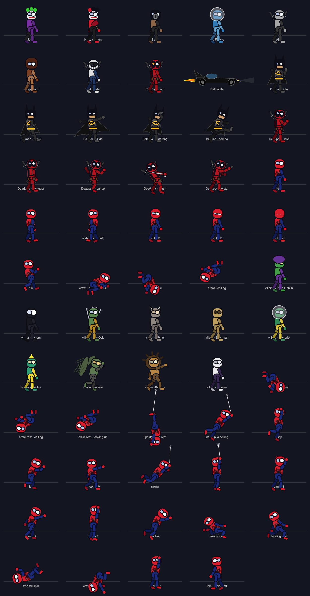

# Super Buddy 🕷️

A tiny superhero who lives on your Mac desktop.

Use **Choose Buddy → Spider-Man / Deadpool / Batman / Hulk** in the shield menu to switch characters.
Your choice is remembered between launches. Deadpool faces Ajax, Juggernaut,
Taskmaster and Evil Deadpool; automatic fights and **Summon a villain!** both use
the selected buddy’s enemy roster. Deadpool wears his red-and-black mask,
utility belt and twin katana scabbards, with a swaggering walk, cheeky idle pose and
his own goofy dance. Deadpool stays on the floor, does somersault jumps and knee-rub landings, and fights
with a drawn katana up close or cartoon pistol shots at range. He does not shoot webs,
swing, cling to walls or hang from the ceiling; those menu commands are hidden for him. Use **Katana slash** or **Fire pistol**
in the menu to trigger his weapon animations while he is standing on the floor.
He also occasionally pauses mid-walk for a katana flourish, then resumes walking.

He walks along the edges of your screen, crawls up the walls and across the ceiling,
jumps, shoots webs and swings around, dangles from the ceiling and finishes every
crash landing with a proper superhero pose — one knee down, fist to the floor,
shockwave and all.

## What he does

| Behaviour | How to see it |
|---|---|
| Walks / runs along the screen edge | just watch — it happens on its own |
| Crawls up the side walls and over the top edge | he keeps walking at a corner and climbs around it — on a wall he is *always* in a crawl stance, never upright |
| On top he never webs around | up on the ceiling the web shooter stays holstered (swinging up there looked wrong); he crawls, rests or lets go instead |
| Jumps | random, or menu → **Jump** |
| Shoots a web and swings across the desktop | random, or menu → **Shoot a web & swing** |
| **Web-zips** straight to the ceiling or a side wall | random, or menu → **Web-zip to the ceiling** / **…to a side wall** — he shoots a line and gets pulled there, arriving in a crawl stance |
| Hangs from a web | random, or menu → **Go hang from the ceiling** |
| Rests while crawling | he simply stops, looks up and down the surface, breathes and blinks |
| Rests **upside down** on the ceiling | random, or menu → **Rest upside-down on the ceiling** — a short thread catches him by the ankle and he dangles head-down |
| **Villains turn up and fight him** | every couple of minutes one of **ten** rogues drops in; the buddy webs him, charges in and trades punches until he is knocked out and legs it — or menu → **Summon a villain!** |
| **Poke him (single click)** | he does a little dance step with music notes |
| **Drag him and let go** | he flails around, falls, and does a **superhero landing** with dust, cracks and a shockwave |
| Double click | he dances right away |
| Eyes | always follow your mouse pointer, and he blinks every few seconds like a real person |

Because the overlay only accepts clicks that land on him, the rest of your desktop
keeps working completely normally — he never blocks your windows, your menu bar or
your Dock. The overlay flips AppKit's `ignoresMouseEvents` 60 times a second based on
where the pointer is, so every click that is not aimed at the buddy goes straight
through to whatever is underneath (and a drag in progress always keeps its events
until you let go).

He does float *above* the Dock and the menu bar — otherwise he would disappear
exactly along the edges he loves walking. If you need him out of the way, use
**Pause / Resume** in the menu bar, or set **Buddy size → Small**.

With more than one monitor he lives on **one screen at a time**, chosen from the
**Display** menu. Stretching the overlay across the bounding box of several displays
looks tempting but is wrong: monitors are rarely aligned, so their bounding box
contains regions that belong to no screen at all, and he would walk into one and
vanish.

## Controls

There is no Dock icon; everything lives in the **menu bar** (shield icon):

* **Come to my cursor** — he leaps to where the pointer is and lands like a hero
* **Dance!**, **Jump**, **Shoot a web & swing**, **Go hang from the ceiling**
* **Buddy size** — Small / Medium / Large
* **Display** — pick which screen he lives on (multi-monitor)
* **Send back home** — back to the middle of the screen
* **Pause / Resume** — freeze him (great while screen sharing)
* **Quit Super Buddy**

## Install with Homebrew

```bash
brew install --cask souvickcse/tap/superbuddy
```

Open **Super Buddy** from Applications, then use the shield icon in the menu bar.
This release is ad-hoc signed, not notarized. If macOS blocks the first launch,
use **System Settings → Privacy & Security → Open Anyway** for Super Buddy.

## Build & run

Requirements: macOS 13+, Xcode command line tools, and [xcodegen](https://github.com/yonaskolb/XcodeGen)
(`brew install xcodegen`).

```bash
cd SuperBuddy
./build.sh Release run
```

Or with make:

```bash
make run        # build + launch
make build      # build only
make preview    # re-render docs/preview.png (all animations)
make check      # headless physics/behaviour smoke test
make icon       # re-render the app icon
make dist       # shareable universal build -> dist/*.zip and dist/*.dmg
make clean      # remove build artefacts
```

### Sharing it with someone

`make dist` produces a **universal** (Apple Silicon **and** Intel) Release build and
wraps it two ways in `dist/`:

* `SuperBuddy-1.0-universal.dmg` — open it, drag the app onto the Applications
  shortcut. Friendliest for other people.
* `SuperBuddy-1.0-universal-macOS.zip` — the same app, zipped.

Both include a **How to open Super Buddy.txt** explaining the one thing that always
trips people up: the app is **ad-hoc signed, not notarised**, because that needs a paid
Apple Developer certificate. The first launch therefore needs a right-click → **Open**
(or `xattr -dr com.apple.quarantine /Applications/SuperBuddy.app`). The note says so in
plain language, so you can forward the file as-is.

Or open `SuperBuddy.xcodeproj` (created by xcodegen — run `xcodegen generate` once),
select the **SuperBuddy** scheme and hit ⌘R.

## Every animation at a glance

`make preview` rasterises the real rig into `docs/preview.png`, so you can see every
state without running the app (it uses Core Graphics only — no window server needed):



The app is ad-hoc signed and unsandboxed, which is what it needs to draw over other
windows. On first launch macOS may ask for permission the first time a click is
swallowed — nothing is ever recorded or sent anywhere, and there is no network code
in the project at all.

## Project layout

```
SuperBuddy/
├── project.yml                  # xcodegen project definition
├── build.sh / Makefile          # command line builds
├── Resources/                   # Info.plist (generated) + AppIcon.icns
├── Tools/
│   ├── preview.swift            # software renderer -> docs/preview.png
│   ├── simcheck.swift           # headless behaviour/physics test
│   ├── icon.swift               # app icon artwork
│   └── make_icon.sh             # png -> icns
└── Sources/
    ├── App/
    │   ├── main.swift           # accessory app bootstrap (no dock icon)
    │   ├── AppDelegate.swift    # overlay window + pointer pass-through watcher
    │   ├── BuddyWindow.swift    # window + click-through-unless-on-him view
    │   └── MenuBar.swift        # 🕷️ status item and commands
    ├── Scene/
    │   ├── BuddyScene.swift     # SpriteKit scene, input, frame loop
    │   └── World.swift          # four walkable edges, corners, gravity helpers
    ├── Buddy/
    │   ├── Buddy.swift          # physics, state machine, mouse interaction
    │   ├── Rig.swift            # the drawn character (8 animated joints)
    │   ├── Pose.swift           # pose data + blending
    │   ├── Motions.swift        # every animation, as a pure function of time
    │   ├── WebLine.swift        # the web strand + splat
    │   └── Effects.swift        # shockwaves, dust, cracks, notes, THWIP!
    └── Support/
        ├── MathUtil.swift       # small vector/angle helpers
        └── Debug.swift          # opt-in trace (only with /tmp/superbuddy.debug)
```

### The rogues gallery

Ten villains, and they do not all fight the same way:

| Archetype | Who | How they fight |
|---|---|---|
| `brawler` | Sandman, Kraven | walks in and trades punches |
| `charger` | Rhino, Venom, Kingpin | backs off, winds up, then barrels in at speed |
| `flyer` | Green Goblin, Vulture | hovers overhead and dives on him (wings on the Vulture) |
| `shooter` | Doctor Octopus, Electro, Mysterio | keeps its distance and fires bolts |

They are all the *same rig* wearing a different `Skin` — colours, headgear (a bonnet,
horns, a dome, a crest, a beak, a mane) and back gear (Doc Ock's four mechanical arms,
the Vulture's wings) come from one struct in `Sources/Buddy/Skin.swift`, and the
archetype decides the fight. A new villain is about ten lines of colour choices.

A `Battle` director (`Sources/Scene/Battle.swift`) picks one at random, drops him in
from above, referees the exchange and clears up afterwards. The buddy is driven by
the director while a fight is on: he webs from range (which *pins* the villain in
place), charges in while the villain is stuck, punches at close range, and dodges
about half of the incoming punches.

### How the character is made

There are **no image assets**. The buddy is drawn at runtime out of `SKShapeNode`s:
a head with two lenses, a red/blue suit with a web pattern and a spider emblem, and
four jointed limbs. The background limbs are drawn in a darker shade behind the body
so he reads as a solid little figure. Every animation is a pure function
(`Motion.walk(t)`, `Motion.dance(t)`, `Motion.heroLanding(t)` …) returning a `Pose`,
and the controller cross-fades between them, so states blend smoothly instead of
snapping.

### How the physics works

Gravity is always straight down in world space, but the buddy tracks the edge he is
standing on and treats that edge's outward normal as *his* up vector. That single
idea gives wall walking, crawling over the ceiling and walking around corners, while
still allowing normal projectile jumps and a rope-constraint web swing
(`|p − anchor| ≤ ropeLength`, with the radial velocity removed each step).

## Batman and the Batmobile

Select **Batman** in **Choose Buddy**. His cowl, animated scalloped cape, bat emblem
and utility belt accompany a deliberate patrol walk, Batarang pose, punch/kick combo,
grappling cable and cape glide. He does not shoot webs or cling upside down.

Batman’s menu adds **Throw Batarang** (⌘B), **Combat combo** (⌘K), **Grapple** (⌘G),
**Glide** (⌘L), and **Batmobile** (⌘M). The single Batmobile command starts a ride;
choose it again while the car is active to bring it back and dismiss it. Click him to scan the area and flip a Batarang. He occasionally does
this during a patrol, or takes an automatic Batmobile ride.

The compact black, finned Batmobile arrives along the bottom edge, parks, opens its
canopy while Batman boards, races at 1,100 points per second with rotating wheels/headlights/exhaust/boost,
climbs both side walls through rounded corner turns, then returns to the floor so
he can step out before it leaves. Dismiss during a climb brings the car back to
its floor parking spot first. Pause freezes the ride. Changing
character/display/size or resetting safely dismisses it. Fighting waits until he
has left the car.

His enemies are **Joker** (gag bombs), **Harley Quinn** (bouncing approach and mallet),
**Bane** (heavy charges), and **Mr. Freeze** (ice bolts). They are stylized procedural
interpretations using the existing battle system.

Run `./.build/simcheck --batman` after `make check` to exercise his movement, all four
villains, grappling/gliding, the full vehicle trip, pause and vehicle cleanup.

## Hulk

Choose **Hulk** for a larger, muscular green buddy with purple shorts and oversized
fists. He patrols on the floor, takes powerful leaps, lands with a shockwave, and
occasionally stops walking for a two-handed smash. Click him for a roar and flex.
His menu provides **Hulk smash!** (⌘K), **Thunderclap** (⌘T), **Super leap** (⌘J),
and **Roar & flex** (⌘D). He has no webs, guns, swords, grappling cable or vehicle.

His opponents are **Abomination**, **Red Hulk**, **Leader**, and **Absorbing Man**.
He closes in for a smash or uses a thunderclap shockwave from a distance.
`./.build/simcheck --hulk` checks his movement, attacks, size/hit area and all four
opponents after `make check`.

## Bat-Signal and bat camouflage

With Batman selected, use **Bat-Signal** (⌘E). A golden spotlight
projects the bat emblem into the sky; 42 animated bats fly in, swirl around Batman,
conceal him for two seconds, then scatter as he reappears. The swarm follows him
as he moves. This is a visual camouflage effect, not an invulnerability power.
Pause freezes the sequence. Reset, character/size/display changes, dragging or
boarding the Batmobile safely reveal him and clean up the effect. Repeated clicks
while it is playing do not create overlapping swarms.
